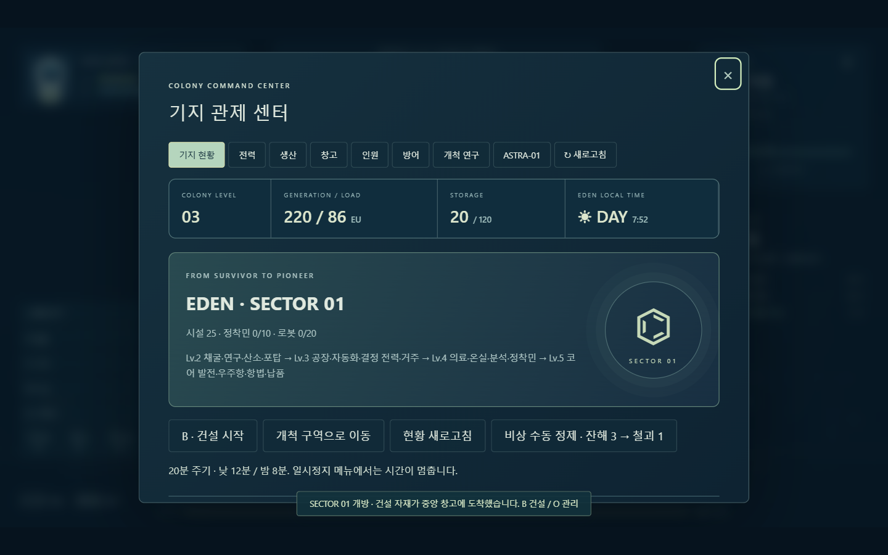
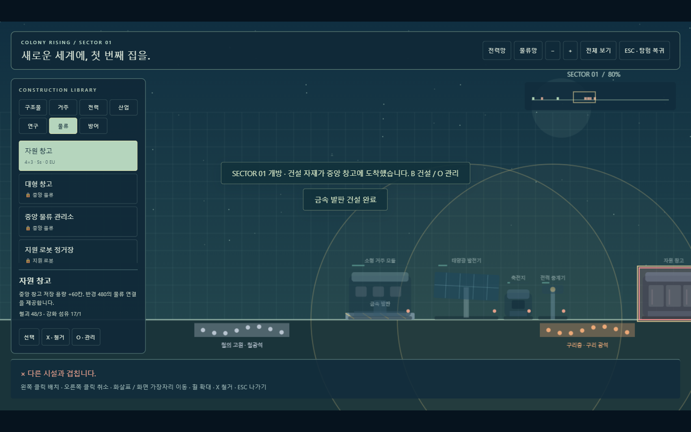

# ASTROTOPIA

**DEVELOPMENT PHASE 4 — COLONY RISING**

FROM SURVIVOR TO PIONEER. EDEN에서 살아남은 탐험가가 첫 번째 기지를 건설합니다.

Phaser + TypeScript + Vite로 만든 PC 브라우저용 2D 액션 RPG입니다. 기존 전투·생존·7개 탐험 지역에 **건설 → 전력 → 자동 채굴 → 정제·생산 → 연구 → 기지 방어 → 우주선 수리 준비**를 연결했습니다.



## 실행

Node.js 22.12 이상 또는 24 LTS와 데스크톱 Chrome 환경을 사용합니다.

```bash
npm ci
npm run dev               # http://127.0.0.1:5180, strict port
npm run build             # TypeScript 검사 + dist/ 정적 번들
npm run preview
npm test
npm run test:e2e           # 실제 Chrome 통합 검사
npm run test:production    # build 후 실행, 디버그 훅 없는 번들 검사
```

개발 포트는 5180입니다. 다른 프로젝트가 사용하는 5173 서버는 변경하지 않습니다. 브라우저 저장은 origin별로 분리되므로 이전 포트의 데이터가 다른 포트로 자동 공유되지는 않습니다.

## 조작

| 키 / 입력                         | 기능                                        |
| --------------------------------- | ------------------------------------------- |
| A/D 또는 ←/→, Space, S/↓          | 이동, 가변 높이 점프, 얇은 발판 아래로 이동 |
| Shift, J/K, 1/2                   | 대시, 기본/특수 공격, 무기 전환             |
| Q E R T / V                       | 공통 스킬 / 스킬 배치                       |
| F                                 | 채굴·조사·기존 시설·새 건물 관리            |
| H / 3·4·5                         | 회복 키트 / 소비 아이템                     |
| I / C / M                         | 인벤토리 / 장비 / 지도                      |
| **L** / N / G                     | 제작·정제·기존 연구·창고 / 도감 / 스캐너    |
| **B**                             | 건설 모드 진입·종료 (설계도 필요)           |
| **O**                             | 기지 관제 센터                              |
| 건설 모드 마우스 이동 / 왼쪽 클릭 | 격자 미리보기 / 배치·선택                   |
| 오른쪽 클릭 / X                   | 설계도 취소 / 철거 모드                     |
| 화살표 / 화면 좌우 가장자리 / 휠  | 건설 카메라 이동 / 확대·축소                |
| Esc                               | 건설 종료 / 메뉴 닫기 / 일시정지            |

기존 B 제작 메뉴는 L로 옮겼습니다. H는 회복 키로 유지하므로 기지 관리는 O입니다. 일반 관리 메뉴에서 생산은 계속되며 Esc 일시정지·설정·조작 메뉴에서는 기지 시간이 멈춥니다. 침공 중 관리 메뉴에서는 침공도 멈춥니다.

## Phase 4 시작과 첫 자동화

1. 기존 퀘스트 1–18, EDEN TITAN, ABYSS SENTINEL과 개척 기술을 완료해 **기지 건설 설계도**를 얻습니다. 기존 저장도 이어서 사용할 수 있습니다. 이전 진행은 [Phase 3 안내](docs/phase-3-guide.md)에 있습니다.
2. 불시착 기지에서 B를 누릅니다. 기존 복구 시설은 무료 등록되고 첫 건설 자재가 중앙 창고에 한 번 지급됩니다. O → **개척 구역으로 이동**으로 평탄한 오른쪽 확장 구역에 갈 수 있습니다. 발광 숲은 기존 경계 근처 F 연결 표지를 사용합니다.
3. **금속 발판·소형 거주 모듈·태양광·중계기·축전지·제작대**를 배치합니다. 녹색 ✓는 배치 가능, 빨간 ×와 문구는 겹침·재료·연구·지지·매장지 문제입니다. 발전기와 중계기의 원 안에 시설 중심이 들어가야 합니다.
4. 연구소에 전력을 공급하고 O → **개척 연구 → 자동 채굴**을 연구합니다. 표시된 철·구리·실리콘·결정 매장지에 채굴기를 놓습니다. MK-II부터 티타늄을 채굴할 수 있습니다.
5. 창고를 생산 시설의 480 범위 안에 놓습니다. 중앙 물류 관리소를 연구·가동하면 기지 전체가 연결됩니다. 건물을 선택하거나 근처에서 F를 눌러 실제 전력·물류 상태를 확인합니다.
6. 정제소에서 레시피와 목표 수량을 설정합니다. **창고 목표까지 반복 보충** 또는 **이번 목표 수량만 생산**을 선택할 수 있습니다. 창고 탭에서 건설용 자원의 **최소 보유량**을 지정하세요.
7. 결정 발전기로 밤에도 전력을 공급하고 공장·거주·산소·레이더·포탑으로 확장합니다. 전력 부족은 순위별로 작업을 멈추며 복구하면 남은 진행부터 이어집니다. 축전지는 200 EU·s, 기본 충·방전 최대 20 EU입니다.
8. 방어 탭에서 **첫 침공**을 직접 시작합니다. 준비 30초 뒤 전투가 시작됩니다. 포탑과 방어벽을 함께 쓰고 손상 시설은 철괴로 수리하세요. 기지를 떠나거나 사망하면 침공이 안전 종료됩니다.
9. 기지 Lv.3에서 레이더로 구조 신호를 수신합니다. 전력·산소가 공급되는 거주 모듈에 정착민을 맞이하고, 시설 선택 후 직업에 맞게 배치합니다. 로봇 정거장에서는 채굴·수리·탐사 보조 로봇을 제작합니다.
10. 의료·온실·첨단 연구·부품 제작소·우주항으로 발전시킵니다. ASTRA-01 탭에서 6종 부품을 납품하고 고대 코어 분석·성계 항법 연구를 완료하면 퀘스트 28이 끝납니다. 실제 발사는 다음 단계입니다.

건설 중 취소와 완성 후 15초 이내 철거는 전액, 이후는 80%(소수점 버림)를 반환합니다. 작업에 보관된 재료는 전액 반환합니다. 창고 용량 축소·반환 공간 부족·지지 발판·거주민 배치·기존 필수 시설 보호 조건을 먼저 검사합니다. 잔해 3개를 철괴 1개로 바꾸는 비상 수동 정제도 관제 센터에 있습니다.



## 구현 범위

**신규 건설 32종 + 기존 터미널, 개척 연구 12개·6분야, 임무 19–28, 시설 Lv.1–3, 기지 Lv.1–5**를 구현했습니다. 기지 레벨은 필요한 시설·연구·거주·발전·수리 준비 상태로 결정합니다.

시설별 목록·기능·업그레이드·전력·생산·방어·정착민·로봇·Phase 5 준비 상태는 [Phase 4 구현 명세](docs/phase-4-implementation.md)에 있습니다. 실제 실행 결과와 제한은 [검증 기록](docs/verification.md)에 기록합니다.

- 기존 6무기·6스킬, 장비·성장, 타이탄과 파수꾼, 환경 위험·산소·채굴 도구, 50개 수동 레시피·25개 기존 기술을 유지합니다.
- 정착민 5직업 최대 10명, 지원 로봇 3종 최대 20대, 자동 온실, 3종 포탑·보호막·레이더를 제공합니다.
- 컨베이어·분배기·물류 드론·물류 로봇·외부 전초기지·독립 지하 건설 구역은 미구현입니다. 현재 중앙 창고 물류와 초기 기지 내 매장지를 사용합니다.
- 자동문·사다리·복잡한 구조 해석, 여러 유형 침공, 실제 우주선 발사·행성 이동·멀티플레이·교역은 후속 범위입니다. 방어벽은 탐험가가 통과할 수 있는 배리어입니다.

## 저장과 오프라인

저장 형식 **v4**, 기존 키 `astrotopia.save.v1` 유지. v1·v2·v3 데이터를 자동 이관하며 이전 원본을 최초 1회 별도 백업합니다. 건설 재료·생산 작업·창고·배터리·연료·인원·연구·납품 기록을 보존하고 전력망과 기지 레벨은 복원 후 계산합니다.

오프라인은 최대 **4시간**입니다. 연료·배터리·입력·목표·창고 조건을 적용하고 태양광은 낮 비율 60%의 평균 출력으로 계산합니다. 오프라인 침공·건물 파괴·정착민 사망은 없습니다. 시계 역행은 생산하지 않습니다. 저장 파일 전체 되돌리기와 시스템 시각 위조를 막는 서버 권한 저장은 아닙니다.

## 주요 변경 파일

- `src/colony/catalog.ts`, `types.ts`, `ColonySystem.ts`: 시설·연구·부품·임무 정의, 건설·전력·자동 생산·물류·성장·인원·방어·오프라인.
- `src/ui/colony-ui.ts`, `src/scenes/colony-art.ts`: 관제 센터·건설 입력·HUD·시설 아트·오버레이.
- `src/core/world.ts`, `src/main.ts`: 기존 월드·확장 지형·건설 카메라·입력·생산 연결.
- `src/save/colony-schema.ts`, `storage.ts`: v4 이관·검증·백업.
- `src/survival/ProductionQueueSystem.ts`, `StorageSystem.ts`: 기존 제작과 창고의 전력·용량 통합.
- `tests/colony.test.ts`, `colony-campaign.test.ts`, `e2e/colony.spec.ts`, `production/colony.spec.ts`: 신규 검증.

절차적 Canvas/SVG 그래픽과 Web Audio 합성 음향을 사용합니다. 타 게임의 에셋이나 외부 폰트 CDN을 사용하지 않습니다. 키 재배치·터치·게임패드·클라우드 저장·전체 화면 스크린리더 플레이는 미지원입니다.

## 환경 설정과 배포

외부 API와 로그인 없이 상대 경로로 동작하므로 현재 필수 환경 변수는 없습니다. 도메인 기능을 추가하면 `.env.example`의 `APP_DOMAIN`/`APP_ORIGIN`을 환경별 중앙 설정으로 읽고 운영 필수값 누락을 오류 처리해야 합니다. 소스에 특정 도메인을 하드코딩하지 않습니다. DNS·인증서·운영 배포는 변경하지 않았습니다.

의존성의 정확한 버전은 `package-lock.json`에 고정됩니다. 프로젝트 자체의 배포 라이선스는 소유자가 별도로 결정합니다.
