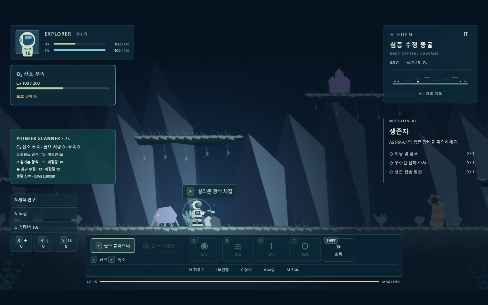

# ASTROTOPIA

**DEVELOPMENT PHASE 3 — SURVIVAL PROTOCOL**

SURVIVE. ADAPT. EVOLVE. 살아남아라. 적응하라. 진화하라.

2478년, ASTRA-01이 EDEN에 불시착했습니다. 전투와 탐험을 통해 자원을 발견하고, 채굴 → 정제 → 연구 → 제작 → 환경 적응으로 더 깊은 지역을 개척하는 PC 브라우저용 2D 액션 RPG입니다.



## 실행

Node.js 22.12 이상 또는 24 LTS, npm, 최신 데스크톱 Chrome을 권장합니다.

```bash
npm ci
npm run dev               # http://127.0.0.1:5180
npm run build             # TypeScript 검사 + dist/ 정적 번들
npm run preview           # 프로덕션 미리보기
npm test                  # 게임 로직·저장·진행 흐름
npm run test:e2e           # 실제 Chrome 브라우저 통합
npm run test:production    # 먼저 build 실행, 전체 오프닝·실제 입력·저장 검사
```

개발 포트는 다른 프로젝트와의 충돌을 피하도록 5180으로 고정했습니다. 기존 5173 포트의 저장 기록은 브라우저 origin이 달라 자동 공유되지 않습니다. 같은 origin에서의 Phase 1·2 저장 데이터는 자동 이관됩니다. Chrome이 없는 환경은 Playwright 설정의 브라우저 채널을 조정하세요.

## 조작

| 키           | 기능                                        |
| ------------ | ------------------------------------------- |
| A/D, ←/→     | 이동                                        |
| Space / S, ↓ | 가변 높이 점프 / 얇은 발판 아래로 이동      |
| Shift        | 대시, 에너지 18, 재사용 2초, 짧은 무적      |
| J / K / 1·2  | 무기 기본 공격 / 특수 공격 / 무기 슬롯 전환 |
| Q E R T / V  | 공통 스킬 / 스킬 배치                       |
| F            | 조사, 채굴, 시설, 연결 표지, 체크포인트     |
| H / 3·4·5    | 회복 키트 / 소비 아이템 빠른 사용           |
| I / C / M    | 인벤토리 / 장비·능력치 / 지도               |
| B / N / G    | 제작·정제·연구·창고 / 도감 / 스캐너         |
| Esc          | 메뉴 닫기 / 일시정지                        |

인벤토리에서 소비 아이템을 선택하면 3·4·5 슬롯에 배치할 수 있습니다. 메뉴를 열면 이동과 전투는 멈추고, 이미 시작한 생산 작업은 계속 진행합니다. 채굴은 이동·점프·공격·대시·피격으로 중단되며, 실패하거나 가방이 가득 차면 광물과 에너지를 소모하지 않습니다.

## Phase 3 진행 안내

1. 기존 퀘스트 1–10과 EDEN TITAN을 완료합니다. 생존 시설은 그전에도 이용할 수 있습니다.
2. 불시착 지점 왼쪽 **생존 터미널(F)**에서 PIONEER SCANNER와 기초 채굴기를 확보합니다. 시작 제작 재료는 창고에 지급됩니다. 기초 제작대에서 의료 젤을 제작합니다.
3. 철·구리·잔해로 **정제소**를 수리합니다. 철괴·구리괴를 만든 뒤 연구 터미널과 장비 작업소를 수리합니다.
4. 기존 발광 숲의 수지·효소를 이용해 생체 소재 → 대기 정화 기술 → **정화 마스크**를 제작합니다. 숲 오른쪽 F 연결 표지에서 독성 습지로 진입합니다.
5. 레이저 절삭기 T2, 산소 공급 모듈과 조명을 제작한 뒤 **심층 수정 동굴**에서 티타늄을 채굴합니다.
6. 소재 공학 → 플라즈마 드릴 T3 → 방사능 차폐복으로 **방사능 유적**을 탐험합니다. 상층 첫 신호와 출구 앞 두 번째 신호를 정렬해 다음 경로를 엽니다.
7. 에너지 안정화 장치를 제작하고 **심층 에너지 지대**에 진입합니다. 양자 추출기 T4로 코어 자원을 채굴할 수 있습니다.
8. **ABYSS SENTINEL**의 공급 장치 두 개를 파괴하면 15초 동안 보호막이 해제됩니다. G로 기믹을 분석하세요. 첫 보상으로 고급 탐험복 설계도와 개척 기술 데이터를 확보합니다.
9. 기지 생존 터미널에서 고대 기술을 분석하고 개척 기술을 연구하면 퀘스트 18과 기지 건설 설계도가 완료됩니다. 자유 건설은 Phase 4에서 이어집니다.

## 생존과 신규 지역

| 지역                 | 환경                       | 대응                    | 주요 자원                                     |
| -------------------- | -------------------------- | ----------------------- | --------------------------------------------- |
| 기존 EDEN 세 지역    | 호흡 가능한 일반 대기      | 별도 장비 불필요        | 철·구리·에너지 결정·실리콘·수지·효소          |
| TOXIC MARSH          | 독성 포자, 상층 안전 경로  | 정화 마스크, 해독제     | 독성 포자·강화 식물 섬유·효소·생태 데이터     |
| DEEP CRYSTAL CAVERNS | 산소 부족, 어둠, 수직 발판 | 산소 모듈·산소통·조명   | 티타늄·희귀 수정·고밀도 결정                  |
| RADIANT RUINS        | 방사능, 고대 회로 퍼즐     | 차폐복·정화제           | 라디언트 결정·고대 금속·외계 회로·고급 데이터 |
| CORE ABYSS           | 에너지 간섭과 예고된 폭발  | 안정화 장치·고급 탐험복 | 코어 결정·희귀 합금·코어 조각                 |

안전 지역에서는 산소가 줄지 않고 노출도가 감소합니다. 위험 진입 시 경고와 최소 6초 유예가 있으며, 산소 20% 이하 및 노출 증가 알림은 반복 간격을 제한합니다. 신규 지역 입구의 대피소는 산소·체력 회복 지점입니다. 위험 지역 저장은 재접속 시 입구 안전 위치와 보호 유예로 복원합니다. 배고픔·갈증·장비 내구도 수리는 없습니다.

## 제작·연구·경제

- **38개 신규 아이템 ID**: 광물 10종 이상, 생체·기술·연구 자원, 철괴·구리괴·웨이퍼·티타늄괴·에너지 셀·강화 섬유·폴리머 등 중간 소재, 소비 아이템, 설계도. 기존 12개 아이템 ID를 유지합니다.
- **50개 레시피**: 기본 정제 9개, 의료 젤·에너지 셀·산소통·해독제·방사능 정화제·비콘·긴급 귀환, 부품·데이터 가공, 환경 장비 6개, 채굴 도구 T2–T4, 가방 확장, 무기 18개, 추가 생체 가공 등.
- **무기 6종 × MK-I/II/III**: 고유 조작과 특수 공격을 유지하며 공격력·치명타 또는 에너지 용량을 차등 강화합니다. 드롭 장비도 유지됩니다.
- **장비 +0~+5 확정 강화**: 단계별 재료·크레딧과 전후 수치 표시, 실패·파괴 없음. 잠금 장비는 판매할 수 없습니다.
- **25개 기술, 5개 분야**: 채굴·소재·생존·무기·개척. 선행 기술, 실제 재료, 포인트와 연구 시간이 적용됩니다. 새 자원·지역·생명체·퀘스트로 포인트를 얻으며 연구 데이터 변환으로 보충할 수 있습니다.
- **생산 대기열 12개**: 시설별 순차 생산, 수량 1/5/10 선택, 일반 정제 3초·고급 5–9초. 다른 지역과 메뉴에서도 계속됩니다. 투입 재료는 시작 시 차감하며 완성품은 기지에서 회수합니다.
- **취소·회수의 일관성**: 진행 중 취소 시 재료와 연구 포인트 100% 반환 대기 상태가 됩니다. 완료 후 취소는 불가합니다. 가방과 창고가 모두 가득 차면 결과물은 작업함에 남습니다. 작업 ID 제거와 지급을 같은 상태 변경으로 처리해 연속 클릭 중복 수령을 방지합니다.
- **창고 60칸**, 가방 24→36칸 확장, 99개 중첩, 수량 이동·일괄 일반 자원 보관. 기지 제작은 가방과 창고 재료를 함께 사용합니다. 검색·분류·이름/희귀도/수량 정렬, 중요 아이템 판매·삭제 방지.
- **PIONEER DATABASE**: 발견 자원·지역·생명체·환경·기술 기록, 도구 등급·획득 지역·관련 레시피. 미발견 자원의 세부 정보는 숨깁니다.

정확한 레시피와 기술 비용은 게임 B 메뉴 및 src/survival/catalog.ts에 있습니다. 새 게임부터 Phase 3 마지막 임무까지 필요한 생산 경로를 자동 통합 테스트로 확인했습니다. 이 테스트는 이동·전투·광물 재생 대기를 단축한 로직 시나리오이며 수동 완주 기록은 아닙니다.

## 기존 기능 유지

- 8장면·24초 오프닝, 3개 기존 지역, 이동·점프·대시·단방향 발판·카메라, 채굴·퀘스트 1–10.
- 6개 무기와 6개 공통 스킬, 콤보·피해 숫자·상태 이상·속성 약점, 9슬롯 장비, 레벨 1–15.
- 10종 기존 몬스터, 6개 엘리트 특성, EDEN TITAN 3페이즈·13패턴, 첫 처치 코어·칭호, 훈련장.
- 신규 환경 몬스터 5종: TOXIC BLOOM, CAVE LURKER, RADIANT WRAITH, CORE GUARDIAN, CRYSTAL DEVOURER. 독성 살포·잠복 기습·에너지 방출·보호막 약점·결정 흡수를 구현했습니다.
- ABYSS SENTINEL은 타이탄과 별개이며 공급 장치·보호막·투사체·파동·범위 공격·결정·드론, 첫 보상/반복 보상을 갖습니다.

## 저장 및 기술 구조

저장 형식 **v3**, 키는 기존 astrotopia.save.v1을 유지합니다. v1·v2는 기본 생존 상태를 추가하여 이관하고 이전 기록을 최초 1회 별도 백업합니다. 기존 장비·레벨·아이템·퀘스트를 유지합니다. 산소·노출·장비·도구·연구·시설·창고·대기열·강화·발견·비콘·보스·설계도·광물 재생 대기를 검증해 저장합니다.

오프라인 처리는 이미 투입한 유한한 대기열만 진행합니다. 음수 시간은 0, 과도한 시간 차이는 최대 하루로 제한하며 회수한 작업을 재지급하지 않습니다. 로컬 저장·시스템 시각의 의도적 조작을 완전히 방지하는 서버 권한 시스템은 아닙니다. 저장 공간 부족·권한 차단 시 오류를 알립니다.

주요 모듈:

- src/core/world.ts — 기존 월드와 전투·생존 연결, 지역·임무·저장.
- src/survival/catalog.ts, regions.ts — 자원·레시피·기술·신규 지역·몬스터·퀘스트 데이터.
- src/survival/ — Survival, Environment, Oxygen, Scanner, Mining, ProductionQueue, Crafting/Refinery, Research/TechnologyTree, Storage, EquipmentUpgrade, Resource/Discovery/Codex, Sentinel 시스템.
- src/combat/ — 기존 분리된 전투·AI·무기·스킬·장비·타이탄.
- src/save/ — v1/v2 이관, v3 방어적 검증.
- src/ui/survival-ui.ts, survival-actions.ts — 작업실·도감·환경 HUD와 입력.
- src/scenes/survival-art.ts — 신규 지역·시설·광물·몬스터·스캐너·채굴·조명 아트.
- tests/survival.test.ts, campaign.test.ts, e2e/survival.spec.ts — 생산·생존·진행 흐름·Chrome 검증.

Phaser 3 + TypeScript + Vite, 자체 Canvas/SVG 절차적 그래픽과 Web Audio 합성 음향을 사용합니다. 외부 상용 게임 에셋·오디오·폰트 CDN은 사용하지 않습니다. 투사체 64개·입자 180개 풀과 화면 범위 제한을 유지합니다.

## 검증과 제한

검증 결과와 측정 범위는 docs/verification.md에 기록합니다. Phase 1·2 기록은 별도 문서로 보존했습니다.

- 자유 건설·전력망·정착민·자동 채굴·식량·행성 이동·우주선 조종·직업·멀티플레이·교역은 이번 단계에 없습니다. 개척 기술은 설계 기록과 후속 건설 해금 상태를 저장합니다.
- 적은 지역 재진입 시 재생성됩니다. 신규 동굴 잠복자는 정해진 지점에서 기습하며 복잡한 벽/천장 경로 탐색은 구현하지 않았습니다. 유적 퍼즐은 두 신호를 순서대로 연결하는 단일 구조입니다.
- 자원 가치는 도감 데이터이며 별도 자원 상점은 없습니다. 다양한 가격 경제·NPC는 후속 범위입니다.
- 모든 경로를 사람 손으로 장시간 완주한 밸런스 검증, 다양한 PC에서의 안정적 60FPS, Firefox/Safari, 실제 스피커 청취는 확인하지 않았습니다.
- 키 재배치·터치·게임패드·클라우드 저장·전체 화면 스크린리더 플레이는 미지원입니다.

## 환경 설정과 배포

외부 API와 로그인 없이 상대 경로로 동작하며 현재 필수 환경 변수는 없습니다. dist/를 정적 호스팅에 사용할 수 있습니다. 도메인 의존 기능을 추가하면 .env.example의 APP_DOMAIN/APP_ORIGIN을 환경별 중앙 설정으로 읽고 운영 필수값 누락을 오류 처리해야 합니다. 특정 도메인을 소스에 하드코딩하지 않습니다. DNS·인증서·운영 배포는 변경하지 않았습니다.

의존성은 Phaser(MIT), Vite(MIT), TypeScript(Apache-2.0), Vitest(MIT), Playwright(Apache-2.0), Prettier(MIT)이며 정확한 버전은 package-lock.json에 고정됩니다. 프로젝트 자체의 배포 라이선스는 소유자가 별도로 결정합니다.
