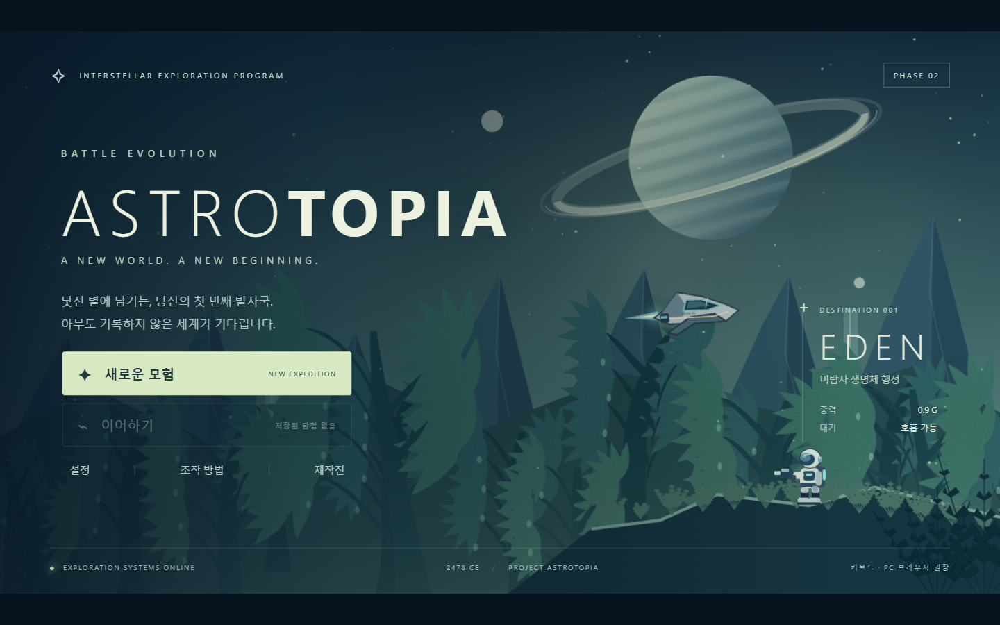

# ASTROTOPIA

**DEVELOPMENT PHASE 2 — BATTLE EVOLUTION**

새로운 세계, 새로운 시작.

서기 2478년, 개척선 ASTRA-01이 미지의 행성 EDEN에 불시착합니다. 우주 탐험가가 되어 세 지역을 탐사하고, 외계 생명체와 전투하며, 고대 유적의 신호를 발견하는 PC 브라우저용 2D 액션 RPG입니다.



## 설치 및 실행

Node.js **22.12 이상 또는 24 LTS**, npm, 최신 데스크톱 브라우저가 필요합니다. 이 프로젝트는 Node.js 24와 Windows Chrome에서 검증했습니다.

```bash
npm ci
npm run dev
```

터미널에 표시된 로컬 주소를 여세요. 기본 주소는 `http://127.0.0.1:5180`입니다. 키보드 조작을 전제로 하며, 모바일 터치 조작은 지원하지 않습니다.

```bash
npm run build             # TypeScript 검사 및 dist/ 프로덕션 번들
npm run preview           # 빌드된 게임 미리보기
npm test                  # 게임 로직 및 저장 데이터 테스트
npm run test:e2e          # 실제 Chrome 통합 테스트
npm run test:production   # 먼저 build 실행: 프로덕션 오프닝·조작·저장 검사
```

브라우저 테스트는 로컬 Google Chrome을 사용합니다. Chrome이 없는 CI 환경은 `npx playwright install chrome`으로 설치하거나 Playwright 설정의 `channel`을 환경에 맞게 조정하세요. 테스트 실행 시 Chrome 실행과 로컬 서버 접근이 허용되어야 합니다.

## 플레이 방법

| 키               | 동작                                           |
| ---------------- | ---------------------------------------------- |
| A / D 또는 ← / → | 좌우 이동                                      |
| Space            | 점프. 오래 누르면 높이 뜁니다.                 |
| Shift            | 대시. 에너지 18 사용, 재사용 대기 2초          |
| S 또는 ↓         | 얇은 발판 아래로 내려가기                      |
| J                | 현재 무기 공격. 캐논은 J를 누른 뒤 놓아 발사   |
| F                | 조사, 채굴 시작, 보급품 열기, 회복 지점 활성화 |
| H                | 회복 키트 사용. 체력 50 회복                   |
| K / 1 / 2        | 무기 특수 공격 / 주무기 / 보조 무기            |
| Q E R T / V / C  | 공통 스킬 / 스킬 배치 / 장비 관리              |
| I / M            | 인벤토리 / 지역 지도                           |
| Esc              | 일시정지, 열린 메뉴 닫기                       |

채굴은 F를 한 번 누르면 진행됩니다. 멀어지거나 공격·대시하면 취소됩니다. 회복 지점 위의 발광 표식을 찾아 F를 누르면 체력과 에너지를 회복하고 귀환 지점을 지정합니다. 메뉴를 열거나 브라우저의 포커스를 잃으면 게임 시간이 멈춥니다.

### 첫 번째 탐험

1. **생존자**: 이동·점프 → ASTRA-01 조사 → 오른쪽 생존 캡슐 확인.
2. **구조 신호**: 통신 장치 확인 → 선체 옆 잔해 3개 채집 → 높은 발판의 에너지 결정 채집. 오른쪽 지상의 결정도 재생성됩니다.
3. **미지의 생명체**: 오른쪽 지역 경계를 지나 발광 숲 진입 → 글로우 슬라임 3마리 처치 → 떨어진 젤 2개 획득.
4. **새로운 가능성**: 수정 계곡 발견 → 누적 에너지 결정 5개 수집 → 맨 오른쪽 고대 유적 조사.

임무의 수집·처치 기록은 누적됩니다. 임무를 받기 전에 수행한 행동도 인정하며 자원은 소모하지 않습니다. 마지막 신호를 확인한 뒤에도 자유롭게 탐험할 수 있습니다. 지역 지도는 탐색용이며 순간이동 기능은 없습니다.

## Phase 2 추가 기능

- 펄스·소총·블레이드·충전 캐논·크라이오·중력 해머: 서로 다른 사거리, 에너지 소모, 콤보와 특수 공격.
- 레벨에 따라 해금되는 6개 공통 스킬, 4슬롯 배치, 대시 무적, 콤보·히트스톱·피해 숫자·화면 흔들림 설정.
- 10종 일반 적, 6개 엘리트 속성, 공격 예고와 회복 구간, 속성 약점과 상태 이상.
- 9개 장비 슬롯, 일반~영웅 획득, 능력치 비교·착용·분해, 가득 찬 가방의 전리품 보존. 전설·초월은 데이터만 존재합니다.
- EDEN TITAN 전용 투기장, 3페이즈·13패턴, 코어 약점, 첫 처치 핵심 보상·칭호, 재도전.
- 불시착 지점 오른쪽 훈련 콘솔(F), 모든 무기·스킬 시험, 보상 없는 허수아비, 종료 시 실제 상태 복원.
- 퀘스트 5–10, 숲 심층·고대 유적, 탐험가/일반/베테랑 난이도.
- 주요 코드: `src/combat/`, `src/data/battle.ts`, `src/scenes/battle-art.ts`, `src/ui/battle-ui.ts`, `src/save/battle-schema.ts`.

## 기존 구현 범위

- 타이틀, 이어하기, 새 모험 초기화 확인, 설정, 조작 안내, 제작진.
- 8장면·24초 오프닝. 버튼, Space, Esc로 건너뛰기.
- 고유 우주복 캐릭터, 11가지 절차적 애니메이션 상태, 좌우 반전, 장비·추진기 표현.
- 가속·감속, 공중 제어, 가변 점프, coyote time, jump buffer, 대시, 단방향 발판, 고정 소단계 충돌 검사.
- 부드러운 카메라, 전방 시야, 수직 추적, 경계 제한, 약한 화면 흔들림.
- 고리 행성·두 위성·산맥·폭포·외계 식물·발광 포자·수정·안개를 포함한 다층 패럴랙스 자체 아트.
- **불시착 지점**: 안전한 시작 지역, 잔해·생존 캡슐·통신 장치·보급품·회복 지점.
- **발광 숲**: 높은 발판의 우회 경로, 지상 전투, 숨겨진 보급품, 동굴 입구.
- **수정 계곡**: 두 협곡, 공중 발판, 수정 동굴 배경, 더 강한 적과 잠긴 고대의 문.
- 펄스 투사체, 총구·명중 효과, 피해 숫자, 넉백, 접촉 피해 무적시간, 적 체력바.
- 글로우 슬라임의 도약, 가시 크롤러의 예고 후 돌진, 스카이 만타의 공중 하강 공격.
- 6종 기초 자원, 적 드롭 3종, 회복 키트. 아이템별 ID·종류·설명·아이콘.
- 24칸 인벤토리, 99개 중첩, 가득 찼을 때 채굴·상자 유지 및 알림.
- 레벨 1–15, 발견·처치·임무 경험치, 레벨업 능력치 증가·체력 회복·효과.
- 한국어 HUD, 임무 추적, 미니맵, 지도, 인벤토리, 진행·획득 알림.
- 사망 애니메이션과 귀환. 자원·경험치 유지, 부활 후 4초 무적.
- LocalStorage 자동·수동 저장, 버전·구조·값 검증, 저장 실패 안내.
- Web Audio 합성 배경 화음·지역 환경음·걷기·무기·채굴·획득·UI 효과음, 음량 설정.
- 전체 화면 설정, 16:9 비율 유지, 낮음/높음 효과 설정.

## 파일 구조와 확장 지점

```text
src/
  main.ts                 Phaser Scene, 생명주기, 화면/입력 연결
  core/
    world.ts              게임 상태, 전투·AI·채굴·퀘스트·지역 전환
    types.ts              상태 및 시스템 간 인터페이스
  data/content.ts         행성, 지역 지형, 적·자원 배치, 아이템, 퀘스트, 오프닝
  physics/movement.ts     독립적으로 테스트 가능한 이동·충돌과 성장 공식
  scenes/art.ts           자체 절차적 아트, 캐시된 배경, 캐릭터·적 렌더러
  systems/
    input.ts              키 상태 및 단일 입력 이벤트
    inventory.ts          중첩/칸 수/원자적 추가 검증
    audio.ts              음향 생성, 지역별 화음, 음량
  save/storage.ts         저장 직렬화·스키마 검증·예외 처리
  ui/
    interface.ts          DOM HUD, 메뉴, 설정, 인벤토리, 접근성
    strings.ts            로케일 확장 시작점
    style.css             화면 및 UI 스타일
tests/
  world.test.ts           게임 시스템과 필수 이동 경로 테스트
  e2e/                    개발 빌드 브라우저 통합 테스트
  production/             개발 훅 없는 배포 번들 검사
docs/
  phase-1-brief.md        제공된 개발 요구사항 원문
  verification.md         검증 방법, 결과, 범위와 미검증 사항
artifacts/                검증 스크린샷 및 성능 샘플
```

Phaser 3는 장면 생명주기, 프레임 루프, Canvas 출력을 담당합니다. 물리와 게임 상태는 Phaser나 DOM에 의존하지 않는 TypeScript 모듈입니다. 그래픽은 절차적으로 생성하여 별도 이미지 다운로드 없이 실행되며, 배경은 지역·깊이별 Canvas에 캐시합니다. 투사체 64개·입자 180개의 풀을 재사용하고 화면에서 먼 객체 업데이트와 렌더링을 제한합니다. 60FPS를 목표로 하며 고주사율 화면에서는 최대 120FPS까지 허용합니다.

### 후속 단계 확장

- `Planet`에는 중력, 대기, 온도, 방사선, 산소, 난도, 생물군계, 적, 자원, 지역 연결, 해금 조건이 있습니다. EDEN의 중력값은 물리에 실제 적용됩니다.
- ARES, FROSTIA, INFERNO, AQUARIA, LUNARIS, OMEGA는 `implemented: false`로만 등록되며 선택 가능한 행성으로 표시하지 않습니다.
- `Region`에 발판·자원·적·조사 지점 배치를 추가하면 기존 이동·전투·인벤토리를 재사용할 수 있습니다.
- 고유 아이템 ID와 분리된 인벤토리 연산을 제작·건설 재료 시스템에 연결할 수 있습니다.
- `WorldEvent`의 `sound`, `toast`, `save`, `ending` 이벤트로 로직과 UI·저장을 분리했습니다.
- 저장 버전은 2입니다. Phase 1 저장은 자동 이관하고 최초 기록을 별도 백업합니다.
- 온라인 협동은 구현하지 않았습니다. 현재 단일 플레이어 상태 모듈을 재사용할 수 있지만 서버 권한 판정·동기화 계층은 별도로 설계해야 합니다.

## 저장과 환경 설정

진행 기록은 `astrotopia.save.v1`, 환경 설정은 `astrotopia.settings.v1`에 저장합니다. 지역 이동, 레벨업, 임무 완료, 자원 획득, 회복 지점, 15초 간격, 수동 저장 및 페이지 숨김 시 저장합니다. 공중에서는 마지막으로 발을 디딘 위치를 기록하고, 불안정한 위치는 로드할 때 안전 위치로 보정합니다. 사망 중 새로고침해도 체크포인트에서 복귀합니다.

저장 데이터에는 레벨·경험치·체력·에너지·지역·안전 위치·인벤토리·임무·발견 지역·열린 보급품·체크포인트·설정·버전이 들어갑니다. 최대 체력과 공격력은 저장된 레벨과 현재 장비·성장 공식에서 재구성합니다.

게임은 **상대 경로만 사용**하고 외부 API, 사용자 로그인, 지정 도메인에 의존하지 않습니다. 현재 배포에 필수 환경 변수는 없습니다. `.env.example`에 향후 `APP_DOMAIN` 및 `APP_ORIGIN`의 설정 위치를 안내했습니다. 서버·OAuth·canonical URL이 추가되면 환경별 중앙 설정에서 읽고, 운영 환경의 필수값 누락은 오류로 처리해야 합니다. 특정 도메인을 소스에 하드코딩하지 않습니다. DNS·인증서·운영 라우팅 변경은 수행하지 않았습니다.

`dist/`는 정적 호스팅에 업로드할 수 있습니다. `base: './'`이므로 하위 경로에서도 에셋을 상대적으로 읽습니다. 저장은 브라우저의 origin별로 분리되므로 호스트·포트·도메인을 변경하면 다른 저장 공간을 사용합니다. 비공개 모드나 사이트 데이터 삭제 시 기록이 사라질 수 있습니다.

## 제한 및 다음 단계

- 자유 키 재배치와 컨트롤러는 미구현입니다. 합성 효과음은 파형·길이·주파수 변화로 구분하며 녹음된 무기 음원은 없습니다.
- 전체 보스전을 사람 손으로 끝까지 공략하는 장시간 밸런스 테스트는 수행하지 않았습니다. 패턴·피해·보상은 로직 테스트, 화면·입력·저장은 브라우저에서 확인합니다.
- Phase 3 생존·정제·제작은 다음 작업으로 이어집니다.

- 제작·기지 건설·전력·산소 설비·우주선 강화·행성 이동·전직·NPC·교역·멀티플레이·우주선 조종은 요구사항에 따라 후속 단계로 남겼습니다.
- 동굴은 지역 내부의 시각적 지형 표현이며 독립된 동굴 인스턴스는 없습니다. 고대의 문은 잠겨 있습니다.
- 자원 재생성 타이머와 살아 있는 적 상태는 세션 메모리에만 있습니다. 지역 재진입 시 적은 초기화되고, 새로고침 시 자원이 재생성됩니다.
- 설정/메뉴 문자열과 콘텐츠는 분리했지만 일부 한국어 HUD·알림은 UI 및 게임 모듈에 있습니다. 완전한 다국어 번역 카탈로그는 후속 작업입니다.
- 음악은 자체 합성 화음과 환경음입니다. 녹음·작곡된 장편 음악이나 음성 연기는 포함하지 않습니다.
- 터치/게임패드, 클라우드 저장, 저장 파일 내보내기, 전체 스크린리더 게임 플레이는 지원하지 않습니다. 메뉴에는 버튼 의미·라벨·포커스 관리가 적용되어 있습니다.
- Chrome에서의 기능 테스트와 짧은 프레임 간격 측정 결과는 `docs/verification.md`에 기록합니다. 다양한 하드웨어의 60FPS, 장시간 플레이, Firefox/Safari는 별도 검증이 필요합니다.

## 에셋 및 출처

캐릭터·몬스터·환경·아이콘의 게임 내 그림은 이 프로젝트에서 제작한 Canvas/SVG/문자 기반 절차적 아트입니다. 외부 게임의 캐릭터·맵·음악·에셋을 사용하지 않았습니다. 배경 화음과 효과음은 Web Audio API로 합성하며 외부 오디오 파일이 없습니다. 시스템 글꼴을 사용하므로 폰트 CDN에 의존하지 않습니다.

개발 의존성: [Phaser 3](https://phaser.io/) (MIT), [Vite](https://vite.dev/) (MIT), [TypeScript](https://www.typescriptlang.org/) (Apache-2.0), [Vitest](https://vitest.dev/) (MIT), [Playwright](https://playwright.dev/) (Apache-2.0), [Prettier](https://prettier.io/) (MIT). 각 패키지의 정확한 버전은 `package-lock.json`에 고정되어 있으며 해당 라이선스는 설치된 패키지에서 확인할 수 있습니다. 프로젝트 자체의 배포 라이선스는 소유자가 별도로 결정합니다.
